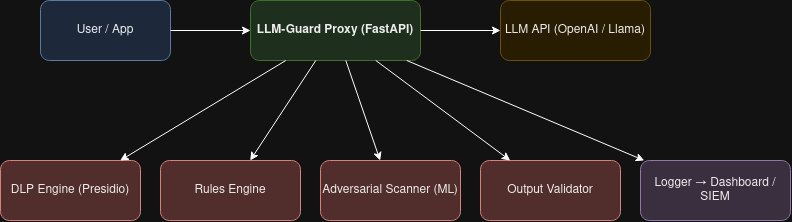

# LLM-Guard: Generative AI Prompt Firewall

Reverse proxy jo LLM ke saamne baith kar prompt injection, jailbreak
aur data leak rokta hai.



## Setup
```
python3 -m venv venv
source venv/bin/activate
pip install -r requirements.txt
```

## Run
```
uvicorn tests.mock_llm:app --port 9000      # mock LLM
uvicorn app.main:app --reload --port 8000   # LLM-Guard proxy
```

## Status
- ## Status
- [x] Day 1: Project setup, proxy skeleton
- [x] Day 2: Reverse proxy forwarding
- [x] Day 3: Streaming + error handling
- [x] DLP engine (mask/unmask)
- [x] Rules Engine (length limit, keyword block)
- [x] Safe system instructions
- [ ] Jailbreak classifier, Output Validator, RBAC, Dashboard
- [x] Jailbreak dataset (collect + clean)
- [x] Baseline classifier (TF-IDF + LogReg)
- [x] Better classifier (word + char n-gram SVM) + model comparison